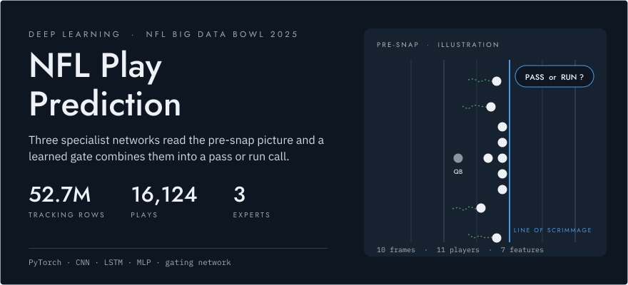
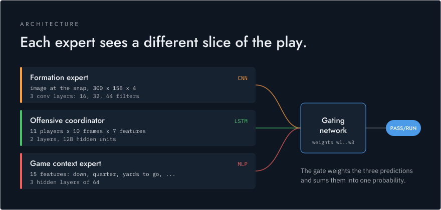
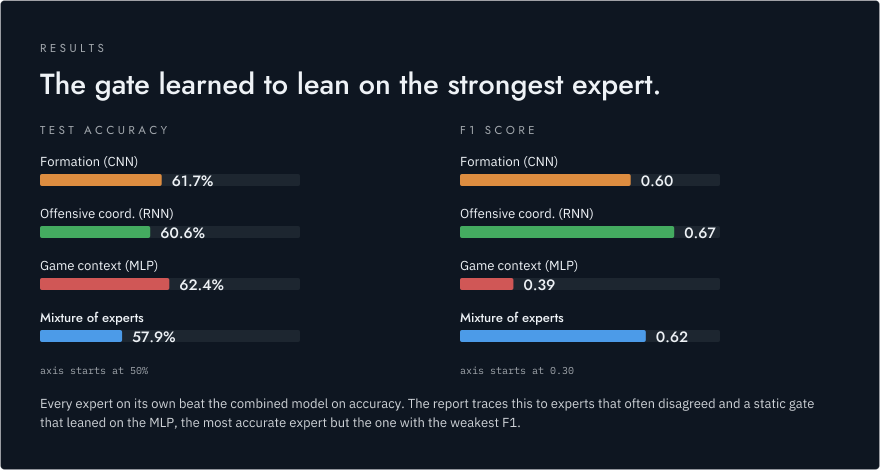
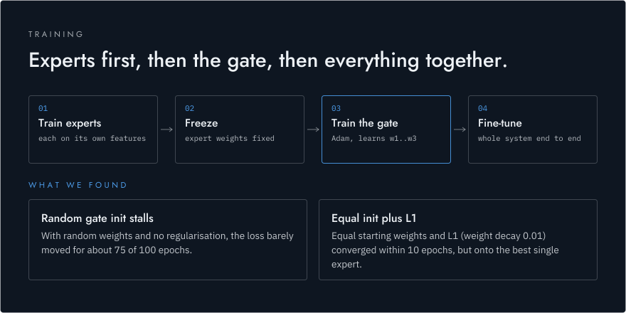

<p align="center">
  <picture>
    <source media="(prefers-color-scheme: dark)" srcset="assets/readme/hero-dark.svg">
    <source media="(prefers-color-scheme: light)" srcset="assets/readme/hero-light.svg">
    
  </picture>
</p>

<p align="center">
  <strong>Predicts whether an NFL play will be a pass or a run, using only what happens before the snap.</strong><br>
  <strong>3 expert networks &middot; 52.7M tracking rows &middot; 16,124 plays</strong> from the NFL Big Data Bowl 2025<br>
  <sub>Shishir Aravindan, Haashir Khan and Myoungjae Kim, University of Toronto. <a href="reports/report.pdf">Read the report</a>.</sub>
</p>

<p align="center">
  
  
  
  
</p>

---

Coaches study pre-snap looks to guess what the offense will do. This project asks whether a model can make that call from tracking data: player positions, motion in the frames before the snap, and the game situation. Instead of one network over everything, it splits the problem across three experts, each built for one kind of input, and trains a gating network to combine their predictions.

## Architecture

<p align="center">
  <picture>
    <source media="(prefers-color-scheme: dark)" srcset="assets/readme/architecture-dark.svg">
    <source media="(prefers-color-scheme: light)" srcset="assets/readme/architecture-light.svg">
    
  </picture>
</p>

| Expert | Input | Model |
|---|---|---|
| [Formation (CNN)](experts/cnn.py) | An image of every player's position at the snap, 300 x 158 with 4 channels | 3 conv layers (16, 32, 64 filters, 3 x 3), batch norm, dropout 0.5, 3 dense layers |
| [Offensive coordinator (RNN)](experts/rnn.py) | 11 offensive players over 10 pre-snap frames, 7 features each (position relative to the QB, speed, acceleration, orientation, direction, angle) | 2-layer LSTM, 128 hidden units, dropout 0.2 |
| [Game context (MLP)](experts/mlp.py) | 15 features such as down, quarter, yards to go and player percentile stats | 3 hidden layers of 64 with ReLU |
| [Gating network](experts/gating_network.py) | The three experts' predictions | Learns a weight for each and sums them into one probability |

The [ETL module](etl/README.md) builds a separate feature set for each expert. Plays have different numbers of pre-snap frames, so it samples the same 10 frames for every player, adds a `timeToSnap` feature, and moves positions into a frame relative to the quarterback. Player stats become percentiles rather than raw totals.

## Results

<p align="center">
  <picture>
    <source media="(prefers-color-scheme: dark)" srcset="assets/readme/results-dark.svg">
    <source media="(prefers-color-scheme: light)" srcset="assets/readme/results-light.svg">
    
  </picture>
</p>

| Model | Test accuracy | F1 |
|---|---|---|
| Formation expert (CNN) | 61.70% | 0.5955 |
| Offensive coordinator (RNN) | 60.60% | 0.6707 |
| Game context expert (MLP) | 62.43% | 0.3925 |
| Mixture of experts | 57.89% | 0.6216 |

The combined model did not beat its experts. Every expert on its own was more accurate, and the RNN had the best F1. The experts often disagreed, and the gate learned one static set of weights for every play, so it leaned on the MLP: the most accurate expert, but the one that struggled most with the less common class. We report F1 next to accuracy because teams pass more than they run, so accuracy alone flatters a model that leans toward passes.

The report's next step is a dynamic gate that picks experts per play rather than one fixed weighting.

## Training

<p align="center">
  <picture>
    <source media="(prefers-color-scheme: dark)" srcset="assets/readme/training-dark.svg">
    <source media="(prefers-color-scheme: light)" srcset="assets/readme/training-light.svg">
    
  </picture>
</p>

1. Train each expert on its own features.
2. Freeze the expert weights.
3. Train the gating network.
4. Fine-tune the whole system end to end.

With random initial weights and no regularisation, the gate barely learned for the first 75 of 100 epochs ([loss and accuracy curves](demo/moe_100epochs.png)). Starting it at equal weights for every expert, with L1 regularisation (weight decay 0.01) to encourage sparsity, it converged within 10 epochs, but to the accuracy of the best single expert ([accuracy by epoch](demo/MoE_acc.png)).

## Getting started

```sh
pip install -r requirements.txt
```

1. Get the features. Either download the pre-generated ones from [Google Drive](https://drive.google.com/drive/folders/13pSIpgwfowXHJcbAjYNnEJwuUUyNFTb-?usp=drive_link) into `demo/features/` (`cnn_features.npy`, `mlp_features.parquet`, `rnn_features.parquet`), or download the Kaggle data and build them with the [ETL module](etl/README.md).
2. Train the experts with [`trainCNN.ipynb`](demo/trainCNN.ipynb), [`trainRNN.ipynb`](demo/trainRNN.ipynb) and [`trainMLP.ipynb`](demo/trainMLP.ipynb), or load the pretrained weights in [`checkpoints/`](checkpoints/).
3. Train the mixture with [`trainMoE.ipynb`](demo/trainMoE.ipynb).

The [experts README](experts/README.md) documents each model. The data is the NFL Big Data Bowl 2025 dataset on Kaggle, licensed CC BY-NC 4.0, so it isn't included here.

## Team

Shishir Aravindan, Haashir Khan and Myoungjae Kim, University of Toronto. The full write-up, including the data analysis and ethical considerations, is in [`reports/report.pdf`](reports/report.pdf).
